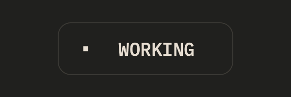
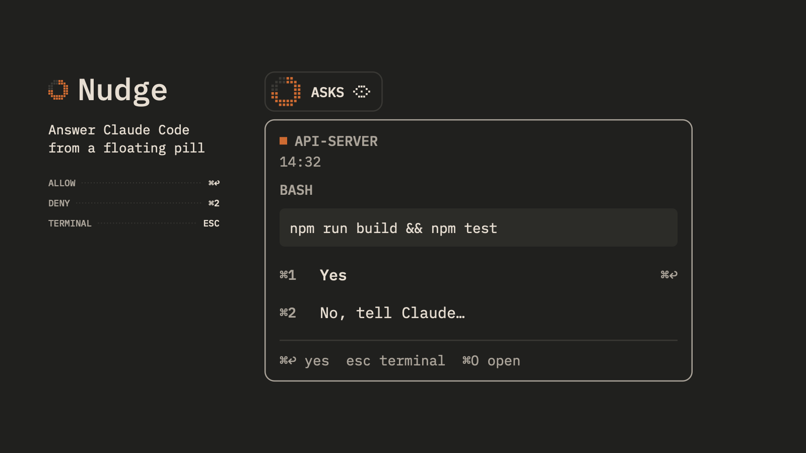

<p align="center">
  
</p>

<h1 align="center">Nudge</h1>

<p align="center">
  Answer Claude Code from a floating pill.<br>
  A small macOS widget that shows what every Claude Code session is doing and lets you approve its
  permission requests without hunting for the right terminal.
</p>

<p align="center">
  <a href="https://github.com/ulvosama/nudge/releases/latest"><b>Download for macOS</b></a> ·
  macOS 14+ · Apple silicon and Intel · free and open source (MIT)
</p>

---

## What it does

<p align="center"></p>

| | |
|---|---|
| **See every session** | The pill shows WORKING, ASKS, APPROVING or YOUR TURN for all your Claude Code sessions. Click it for the list. |
| **Answer from the pill** | When Claude asks for permission, the pill turns orange and a card shows the command. ⌘↩ allows, ⌘1–9 picks an option, Esc hands it back to the terminal. |
| **Stay awake** (eye) | Keeps the Mac awake while Claude works on power, and lets it sleep when it's done. |
| **Auto-approve** (check) | Says yes for you for 1–24 h. It only turns on after Touch ID or your password. |
| **Quick mode** (bolt) | Auto-approve in under a second, silently, with APPROVING on the pill. |
| **Permission log** | Every request and decision from the last 24 h, exportable as CSV. |
| **`nudge://` links** | Switch modes from a script or from inside a Claude session (see below). |

## Install

1. Download **Nudge.dmg** from the [latest release](https://github.com/ulvosama/nudge/releases/latest).
2. Drag Nudge to Applications and open it.
3. The Welcome window asks before connecting to Claude Code: it adds a few hooks to
   `~/.claude/settings.json` (a backup is kept). Restart Claude Code sessions that were already running.

That's it. Nudge starts at login, and updates itself from GitHub Releases: each update is checked
against its published checksum and must be signed by the same developer and notarized by Apple.

Right-click the pill for the menu.

## Shortcuts

| | |
|---|---|
| Allow | ⌘↩ |
| Pick an option | ⌘1–9 |
| Answer in the terminal instead | Esc |
| Jump to the question from anywhere | ⌃⌥J |
| Menu | right-click the pill |

## `nudge://` links

```sh
open nudge://awake/on                     # or awake/off
open nudge://auto/off
open "nudge://auto/on?mode=quick&hours=4" # mode=quick|normal, hours=1..24, questions=0|1, awake=0|1
```

`auto/on` never turns auto-approve on by itself: it opens the confirmation, and you confirm with
Touch ID or your password. That makes it safe to let Claude prepare the switch for you.

## Privacy

Everything stays on your Mac. The only network request is the update check against GitHub. See
[SECURITY.md](SECURITY.md) for exactly which files Nudge reads and writes, and how auto-approve and
updates are protected.

## Uninstall

Menu → **Uninstall Nudge…** removes the hooks, `~/.nudge`, the login item and the app. To remove only
the hooks, use **Remove Claude Code hooks**. They stay removed until you add them again.

## Build from source

Needs the Xcode command-line tools (`xcode-select --install`).

```sh
git clone https://github.com/ulvosama/nudge && cd nudge
./build.sh                  # -> build/Nudge.app (universal) and dist/Nudge.dmg
./tests/run.sh              # Suite A (hook helper) and Suite B (app logic), sandboxed
ditto build/Nudge.app /Applications/Nudge.app && open /Applications/Nudge.app
```

A copy built from source can update itself from this folder: turn on **Update automatically** in
the menu. It then pulls `main` when the folder has no uncommitted changes, builds, runs both test
suites, and installs only if everything passes and no question is waiting. Details go to
`~/.nudge/update.log`. It's off by default, because it builds whatever is on `main`.

Two further suites run by hand: `tests/e2e_claude.py <scratch-dir>` drives a real Claude Code session
(and uses tokens), and `tests/screen_smoke.sh <scratch-dir>` takes screenshots of the app with a
fake question.

Releases: `scripts/release.sh <version>` (Developer ID signing, notarization, GitHub release).

## How it works

```
Claude Code ──hook──> ~/.nudge/hook.sh ──> nudge-hook (in the app)
                                              │ holds the request (up to 5 min)
                                              ▼
                               ~/.nudge/requests/<id>.json ──> Nudge (the pill) ──> you
                               ~/.nudge/responses/<id>.json <── your answer
```

Claude's own `~/.claude/sessions/*.json` gives each session's status. If Nudge isn't running, the
helper steps aside at once and Claude asks in the terminal as usual.

---

Fonts: IBM Plex Mono (SIL Open Font License, see `Resources/Fonts/OFL.txt`).
Nudge is an independent project, not affiliated with or endorsed by Anthropic.
